# ルート(make_map.py が config/map/course.yaml から自動生成。直接編集しない)
スタートで5秒待つ → 椅子ごとに入口 → 出口(椅子の真下を通り抜けてサンプルの上を通過)→ ゴール。 移動の前にその場で進む向きを向く(drive_mode: forward、横滑り対策)。
順番: 1 → 2 → 3 → 4 → 5 → 6 → 7 → 8(推定の移動コスト 19.8 m 相当)

```mermaid
stateDiagram-v2

[*] --> 待機 : wait(duration_sec = 5.0)
待機 --> 椅子1_入口_向き : set_pose(x = 0.556, y = 0.639, yaw = 68.2)
椅子1_入口_向き --> 椅子1_入口_手前2 : set_pose(x = 0.550, y = 1.000, yaw = 68.2)
椅子1_入口_手前2 --> 椅子1_入口_手前 : set_pose(x = 0.700, y = 1.000, yaw = 0.0)
椅子1_入口_手前 --> 椅子1_停止 : wait(duration_sec = 1.5)
椅子1_停止 --> 椅子1_入口 : set_pose(x = 0.850, y = 1.000, yaw = 0.0)
椅子1_入口 --> 椅子1_出口 : set_pose(x = 1.550, y = 1.000, yaw = 0.0)
椅子1_出口 --> 椅子2_入口_離れる : set_pose(x = 1.700, y = 1.000, yaw = -56.3)
椅子2_入口_離れる --> 椅子2_入口_手前2 : set_pose(x = 1.750, y = 0.700, yaw = -56.3)
椅子2_入口_手前2 --> 椅子2_入口_手前 : set_pose(x = 1.900, y = 0.700, yaw = 0.0)
椅子2_入口_手前 --> 椅子2_停止 : wait(duration_sec = 1.5)
椅子2_停止 --> 椅子2_入口 : set_pose(x = 2.050, y = 0.700, yaw = 0.0)
椅子2_入口 --> 椅子2_出口 : set_pose(x = 2.750, y = 0.700, yaw = 0.0)
椅子2_出口 --> 椅子3_入口_離れる : set_pose(x = 2.900, y = 0.700, yaw = -6.3)
椅子3_入口_離れる --> 椅子3_入口_手前2 : set_pose(x = 3.650, y = 0.600, yaw = -6.3)
椅子3_入口_手前2 --> 椅子3_入口_手前 : set_pose(x = 3.800, y = 0.600, yaw = 0.0)
椅子3_入口_手前 --> 椅子3_停止 : wait(duration_sec = 1.5)
椅子3_停止 --> 椅子3_入口 : set_pose(x = 3.950, y = 0.600, yaw = 0.0)
椅子3_入口 --> 椅子3_出口 : set_pose(x = 4.650, y = 0.600, yaw = 0.0)
椅子3_出口 --> 椅子4_入口_離れる : set_pose(x = 4.800, y = 0.600, yaw = -56.3)
椅子4_入口_離れる --> 椅子4_入口_回る1向き : set_pose(x = 4.745, y = 0.740, yaw = -68.7)
椅子4_入口_回る1向き --> 椅子4_入口_回る1 : set_pose(x = 4.660, y = 0.960, yaw = -68.7)
椅子4_入口_回る1 --> 椅子4_入口_向き : set_pose(x = 4.562, y = 1.074, yaw = -49.6)
椅子4_入口_向き --> 椅子4_入口_手前2 : set_pose(x = 4.200, y = 1.350, yaw = -49.6)
椅子4_入口_手前2 --> 椅子4_入口_手前 : set_pose(x = 4.200, y = 1.500, yaw = -90.0)
椅子4_入口_手前 --> 椅子4_停止 : wait(duration_sec = 1.5)
椅子4_停止 --> 椅子4_入口 : set_pose(x = 4.200, y = 1.650, yaw = -90.0)
椅子4_入口 --> 椅子4_出口 : set_pose(x = 4.200, y = 2.350, yaw = -90.0)
椅子4_出口 --> 椅子5_入口_離れる : set_pose(x = 4.200, y = 2.500, yaw = -122.0)
椅子5_入口_離れる --> 椅子5_入口_手前2 : set_pose(x = 4.850, y = 3.300, yaw = -122.0)
椅子5_入口_手前2 --> 椅子5_入口_手前 : set_pose(x = 4.700, y = 3.300, yaw = -180.0)
椅子5_入口_手前 --> 椅子5_停止 : wait(duration_sec = 1.5)
椅子5_停止 --> 椅子5_入口 : set_pose(x = 4.550, y = 3.300, yaw = -180.0)
椅子5_入口 --> 椅子5_出口 : set_pose(x = 3.850, y = 3.300, yaw = -180.0)
椅子5_出口 --> 椅子6_入口_離れる : set_pose(x = 3.700, y = 3.300, yaw = -180.0)
椅子6_入口_離れる --> 椅子6_入口_手前 : set_pose(x = 3.400, y = 3.300, yaw = -180.0)
椅子6_入口_手前 --> 椅子6_停止 : wait(duration_sec = 1.5)
椅子6_停止 --> 椅子6_入口 : set_pose(x = 3.250, y = 3.300, yaw = -180.0)
椅子6_入口 --> 椅子6_出口 : set_pose(x = 2.550, y = 3.300, yaw = -180.0)
椅子6_出口 --> 椅子7_入口_離れる : set_pose(x = 2.400, y = 3.300, yaw = 173.7)
椅子7_入口_離れる --> 椅子7_入口_手前2 : set_pose(x = 1.650, y = 3.400, yaw = 173.7)
椅子7_入口_手前2 --> 椅子7_入口_手前 : set_pose(x = 1.500, y = 3.400, yaw = -180.0)
椅子7_入口_手前 --> 椅子7_停止 : wait(duration_sec = 1.5)
椅子7_停止 --> 椅子7_入口 : set_pose(x = 1.350, y = 3.400, yaw = -180.0)
椅子7_入口 --> 椅子7_出口 : set_pose(x = 0.650, y = 3.400, yaw = -180.0)
椅子7_出口 --> 椅子8_入口_離れる : set_pose(x = 0.500, y = 3.400, yaw = 113.2)
椅子8_入口_離れる --> 椅子8_入口_手前2 : set_pose(x = 0.800, y = 2.850, yaw = 113.2)
椅子8_入口_手前2 --> 椅子8_入口_手前 : set_pose(x = 0.800, y = 2.700, yaw = 90.0)
椅子8_入口_手前 --> 椅子8_停止 : wait(duration_sec = 1.5)
椅子8_停止 --> 椅子8_入口 : set_pose(x = 0.800, y = 2.550, yaw = 90.0)
椅子8_入口 --> 椅子8_出口 : set_pose(x = 0.800, y = 1.850, yaw = 90.0)
椅子8_出口 --> ゴール_離れる : set_pose(x = 0.800, y = 1.700, yaw = 12.5)
ゴール_離れる --> ゴール_手前 : set_pose(x = 2.004, y = 1.967, yaw = 12.5)
ゴール_手前 --> [*] : set_pose(x = 2.150, y = 2.000, yaw = 0.0)
```

